# Between Lines

[← All variants](README.md) · [Puzzles](../features-puzzles.md) · [How to play](../how-to-play.md)

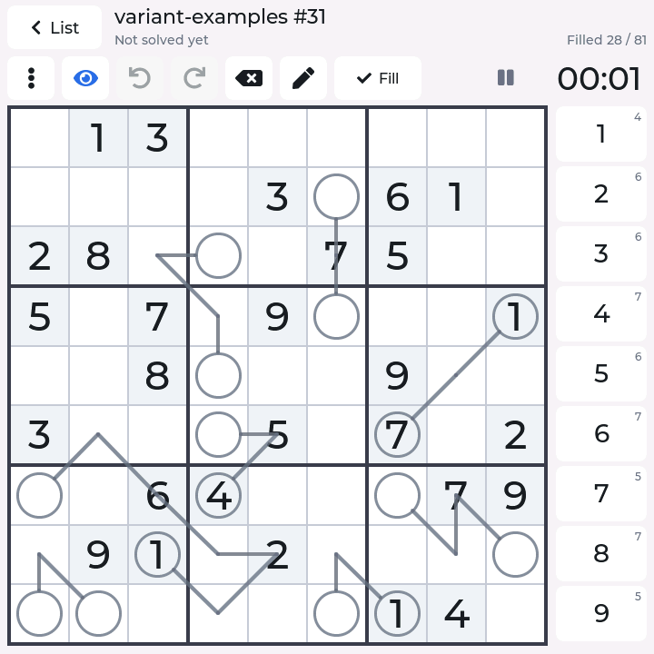

## The rules

[Classic](classic.md) rules, plus **grey lines with a circle at each end**, through cells side by side or diagonal. Every digit on a line, between its two circles, lies **strictly between the two circled digits**: with 3 and 8 in the circles, the cells between hold 4 to 7. Either circle can be the smaller one, and the cells between may repeat a digit where the rows, columns and boxes allow it.

## On the board

- Each line is a grey line from one ring to the other.
- With both circles filled, a digit on the line that isn't strictly between them turns red, with the circles.
- The grader and hints keep, for each cell, the digits some pair of circles allows, and for each circle the digits that leave every cell between something to hold: "The digits on this line lie between the digits in its two circles, so row 6, column 3 can only be 9".
- **Puzzles → ⋮ → New puzzle → Lines → Between**: 8 lines (Hard and Expert 10) of 3 to 7 cells.

## How to solve it

- **The circles are far apart:** a line with a 7 between its circles has one circle at 6 or less and the other at 8 or more.
- **Long lines need wide gaps:** the cells between are often different digits (in a row or box), so the gap must fit them: four different digits between need circles at least 5 apart.
- **A circle at 1 or 9 settles the side:** the other circle is the high (or low) end.
- **No 1 or 9 between:** nothing is strictly below 1 or above 9.

## Worked example

**variant-examples #31**, Between Lines Easy (see [Classic](classic.md#worked-example-the-whole-puzzle) for how to import the examples; cells are written r*row*c*column*). The lines are in the screenshot; three matter here:

- a line of **four**: circles at r5c4 and r3c4, with r4c4 and r3c3 between;
- a line of **three**: circles at r7c4 (a 4) and r6c4, with r6c5 (a 5) between;
- a line of **seven**: circles at r8c3 (a 1) and r7c1, with r9c4, r8c5 (a 2), r8c4, r7c3 (a 6) and r6c2 between.

**Step 1: r3c3, between the circles of the line of four.** Row 3 has 2, 5, 7 and 8; column 3 has 1, 3, 6, 7 and 8: that leaves 4 and 9. Nothing is above 9, so a 9 can never be strictly between two circles. **r3c3 = 4**.

**Step 2: the 1 in row 6.** Row 6 has 2, 3, 5 and 7. The 1s in r1c2, r8c3 and r2c8 rule out r6c2, r6c3 and r6c8. That leaves r6c4 and r6c6. r6c4 is a circle of the line of three, whose other circle is a 4 with a 5 between them: r6c4 must be above 5. **r6c6 = 1**.

**Step 3: the 9 in row 9.** Row 9 has 1 and 4. The 9 in r8c2 rules out r9c1 to r9c3, the 9s in r4c5 and r7c9 rule out r9c5 and r9c9. That leaves r9c4 and r9c6. r9c4 is between the circles of the line of seven, one of them a 1: it must be below the other circle, and nothing is above 9. **r9c6 = 9**.

## The whole puzzle, step by step

<!-- walkthrough -->
<!-- Written by tools/walkthrough.py between-lines: edit the script, not this part. -->

The whole puzzle, from the start to the last cell: 53 steps, each one a single (one place left for a digit, or one digit left for a cell), taken in the order a box's single comes first, so not quite the order of the worked example above. In each picture, the unit the step looks at is tinted yellow (for a cell with one digit left: its row, column and box), the new digit is on green, the digits that rule cells out have an **orange ring**, and the empty cells they rule out a **red cross**. Givens are on grey, digits from earlier steps in blue.

#### Step 1: the 6 in box 1

Box 1 needs a 6. r2c1, r2c2 and r2c3: row 2 has one (r2c7). r3c3: column 3 has one (r7c3). Only **r1c1** is left: **r1c1 = 6**.

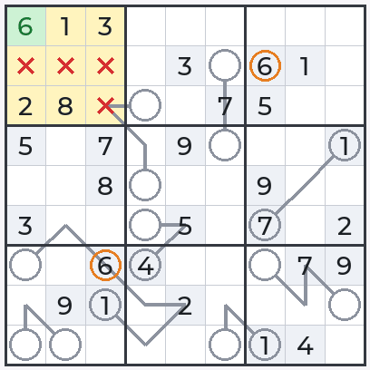

#### Step 2: the 1 in box 4

Box 4 needs a 1. r4c2: row 4 has one (r4c9). r5c2 and r6c2: column 2 has one (r1c2). r6c3: column 3 has one (r8c3). Only **r5c1** is left: **r5c1 = 1**.

#### Step 3: the 9 in box 4

Box 4 needs a 9. r4c2: row 4 has one (r4c5). r5c2: row 5 has one (r5c7). r6c2: column 2 has one (r8c2). Only **r6c3** is left: **r6c3 = 9**.

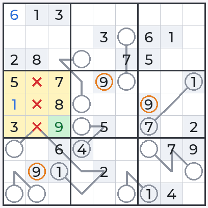

#### Step 4: the 9 in box 1

Box 1 needs a 9. r2c2: column 2 has one (r8c2). r2c3 and r3c3: column 3 has one (r6c3). Only **r2c1** is left: **r2c1 = 9**.

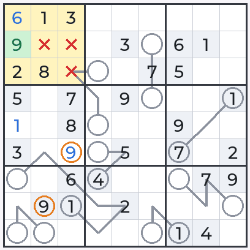

#### Step 5: the 7 in box 1

Box 1 needs a 7. r2c3: column 3 has one (r4c3). r3c3: row 3 has one (r3c6). Only **r2c2** is left: **r2c2 = 7**.

#### Step 6: the 5 in box 1

Box 1 needs a 5. r3c3: row 3 has one (r3c7). Only **r2c3** is left: **r2c3 = 5**.

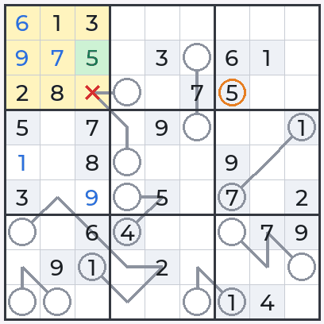

#### Step 7: the 4 in box 1

Box 1 needs a 4, and r3c3 is its last empty cell: **r3c3 = 4**.

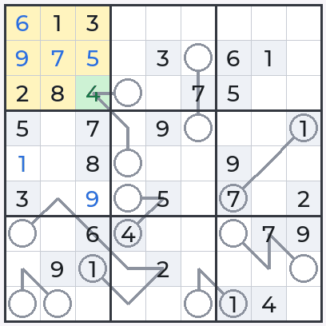

#### Step 8: the 7 in box 3

Box 3 needs a 7. r1c7: column 7 has one (r6c7). r1c8: column 8 has one (r7c8). r2c9: row 2 has one (r2c2). r3c8 and r3c9: row 3 has one (r3c6). Only **r1c9** is left: **r1c9 = 7**.

#### Step 9: the 1 in box 5

Box 5 needs a 1. r4c4 and r4c6: row 4 has one (r4c9). r5c4, r5c5 and r5c6: row 5 has one (r5c1). r6c4: it's a circle, and its line already has 5 between it and the 4 in r7c4: a 1 there wouldn't leave them strictly between. Only **r6c6** is left: **r6c6 = 1**.

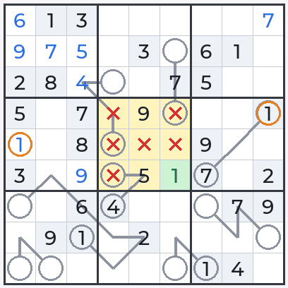

#### Step 10: the 4 in box 7

Box 7 needs a 4. r7c1 and r7c2: row 7 has one (r7c4). r9c1, r9c2 and r9c3: row 9 has one (r9c8). Only **r8c1** is left: **r8c1 = 4**.

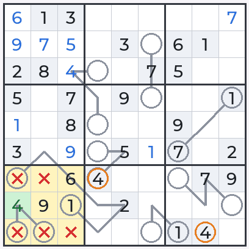

#### Step 11: the 7 in box 7

Box 7 needs a 7. r7c1 and r7c2: row 7 has one (r7c8). r9c2: column 2 has one (r2c2). r9c3: column 3 has one (r4c3). Only **r9c1** is left: **r9c1 = 7**.

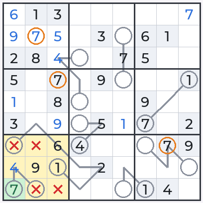

#### Step 12: the 5 in box 7

Box 7 needs a 5. r7c1: column 1 has one (r4c1). r9c3: column 3 has one (r2c3). r9c2: it's a circle, and its line already has 4 between it and the 7 in r9c1: a 5 there wouldn't leave them strictly between. Only **r7c2** is left: **r7c2 = 5**.

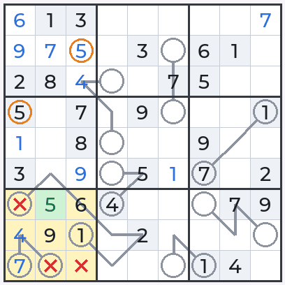

#### Step 13: the 3 in box 7

Box 7 needs a 3. r7c1: column 1 has one (r6c1). r9c3: column 3 has one (r1c3). Only **r9c2** is left: **r9c2 = 3**.

#### Step 14: the 2 in box 7

Box 7 needs a 2. r7c1: column 1 has one (r3c1). Only **r9c3** is left: **r9c3 = 2**.

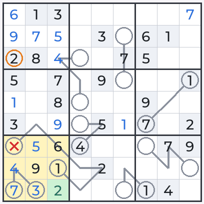

#### Step 15: the 8 in box 7

Box 7 needs an 8, and r7c1 is its last empty cell: **r7c1 = 8**.

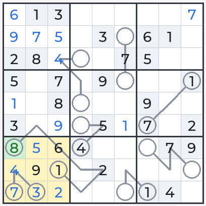

#### Step 16: the 1 in box 8

Box 8 needs a 1. r7c6: column 6 has one (r6c6). r8c4 and r8c6: row 8 has one (r8c3). r9c4, r9c5 and r9c6: row 9 has one (r9c7). Only **r7c5** is left: **r7c5 = 1**.

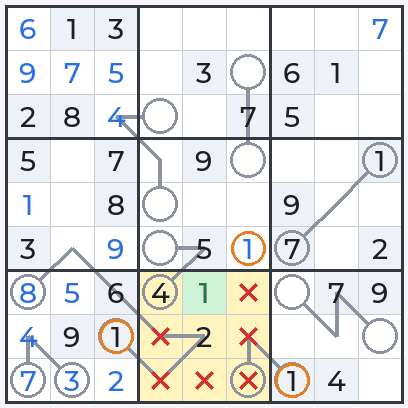

#### Step 17: the 1 in box 2

Box 2 needs a 1. r1c4, r1c5 and r1c6: row 1 has one (r1c2). r2c4 and r2c6: row 2 has one (r2c8). r3c5: column 5 has one (r7c5). Only **r3c4** is left: **r3c4 = 1**.

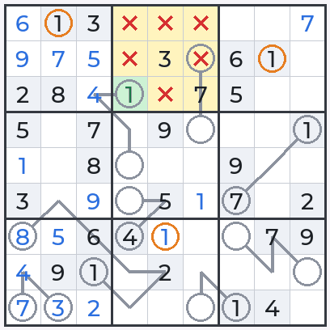

#### Step 18: the 6 in box 2

Box 2 needs a 6. r1c4, r1c5 and r1c6: row 1 has one (r1c1). r2c4 and r2c6: row 2 has one (r2c7). Only **r3c5** is left: **r3c5 = 6**.

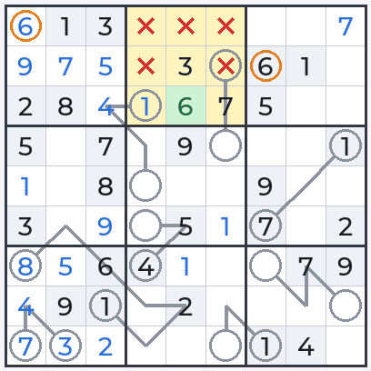

#### Step 19: the 7 in box 8

Box 8 needs a 7. r7c6: row 7 has one (r7c8). r8c6: column 6 has one (r3c6). r9c4, r9c5 and r9c6: row 9 has one (r9c1). Only **r8c4** is left: **r8c4 = 7**.

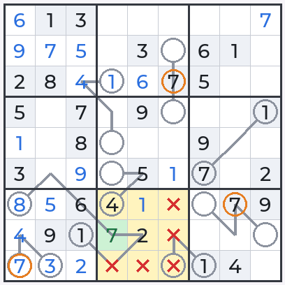

#### Step 20: the 7 in box 5

Box 5 needs a 7. r4c4 and r4c6: row 4 has one (r4c3). r5c4: column 4 has one (r8c4). r5c6: column 6 has one (r3c6). r6c4: row 6 has one (r6c7). Only **r5c5** is left: **r5c5 = 7**.

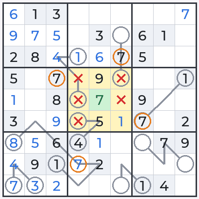

#### Step 21: the 9 in box 8

Box 8 needs a 9. r7c6: row 7 has one (r7c9). r8c6: row 8 has one (r8c2). r9c5: column 5 has one (r4c5). r9c4: it's on the line between the circles 1 and 8, so it's 2 to 7. Only **r9c6** is left: **r9c6 = 9**.

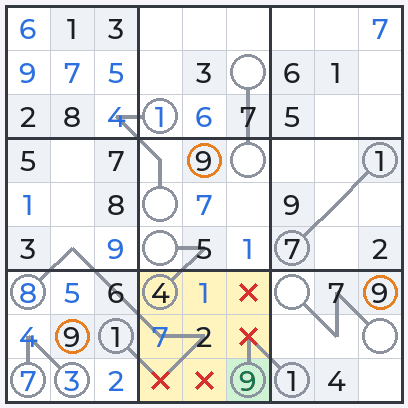

#### Step 22: the 9 in box 2

Box 2 needs a 9. r1c5: column 5 has one (r4c5). r1c6: column 6 has one (r9c6). r2c4 and r2c6: row 2 has one (r2c1). Only **r1c4** is left: **r1c4 = 9**.

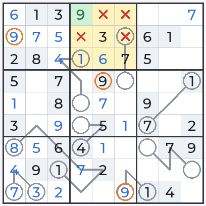

#### Step 23: the 5 in box 2

Box 2 needs a 5. r1c5: column 5 has one (r6c5). r2c4 and r2c6: row 2 has one (r2c3). Only **r1c6** is left: **r1c6 = 5**.

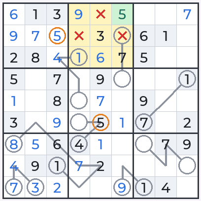

#### Step 24: the 9 in box 3

Box 3 needs a 9. r1c7 and r1c8: row 1 has one (r1c4). r2c9: row 2 has one (r2c1). r3c9: column 9 has one (r7c9). Only **r3c8** is left: **r3c8 = 9**.

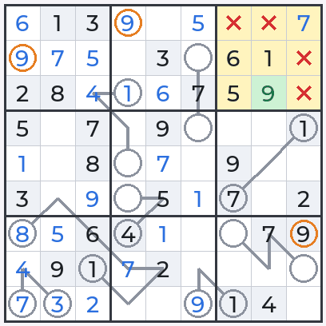

#### Step 25: the 3 in box 3

Box 3 needs a 3. r1c7 and r1c8: row 1 has one (r1c3). r2c9: row 2 has one (r2c5). Only **r3c9** is left: **r3c9 = 3**.

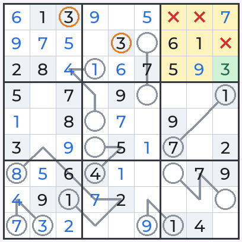

#### Step 26: the 5 in box 8

Box 8 needs a 5. r7c6: row 7 has one (r7c2). r8c6: column 6 has one (r1c6). r9c5: column 5 has one (r6c5). Only **r9c4** is left: **r9c4 = 5**.

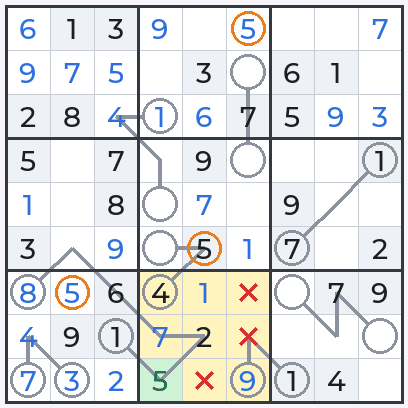

#### Step 27: the 6 in box 8

Box 8 needs a 6. r7c6: row 7 has one (r7c3). r9c5: column 5 has one (r3c5). Only **r8c6** is left: **r8c6 = 6**.

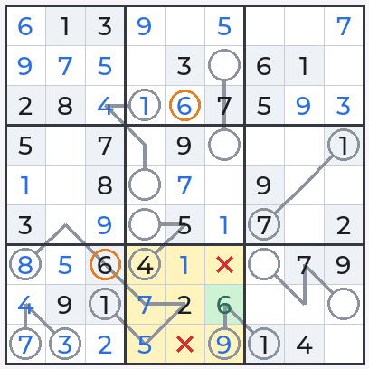

#### Step 28: the 3 in box 8

Box 8 needs a 3. r9c5: row 9 has one (r9c2). Only **r7c6** is left: **r7c6 = 3**.

#### Step 29: the 3 in box 5

Box 5 needs a 3. r4c6 and r5c6: column 6 has one (r7c6). r6c4: row 6 has one (r6c1). r5c4: it's a circle, and its line already has 4 between it and the 1 in r3c4: a 3 there wouldn't leave them strictly between. Only **r4c4** is left: **r4c4 = 3**.

#### Step 30: the 3 in box 6

Box 6 needs a 3. r4c7 and r4c8: row 4 has one (r4c4). r5c9: column 9 has one (r3c9). r6c8: row 6 has one (r6c1). Only **r5c8** is left: **r5c8 = 3**.

#### Step 31: the 5 in box 6

Box 6 needs a 5. r4c7 and r4c8: row 4 has one (r4c1). r6c8: row 6 has one (r6c5). Only **r5c9** is left: **r5c9 = 5**.

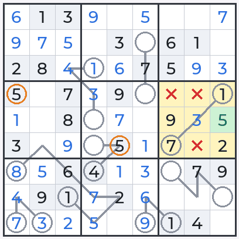

#### Step 32: the 4 in box 6

Box 6 needs a 4. r4c8 and r6c8: column 8 has one (r9c8). Only **r4c7** is left: **r4c7 = 4**.

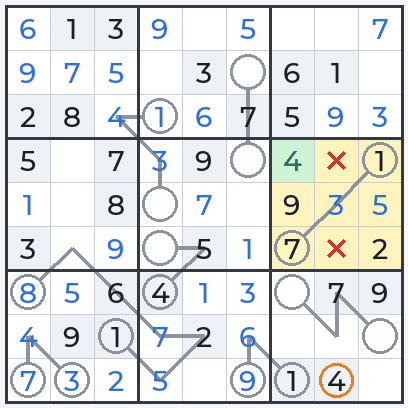

#### Step 33: the 4 in box 3

Box 3 needs a 4. r1c7: column 7 has one (r4c7). r1c8: column 8 has one (r9c8). Only **r2c9** is left: **r2c9 = 4**.

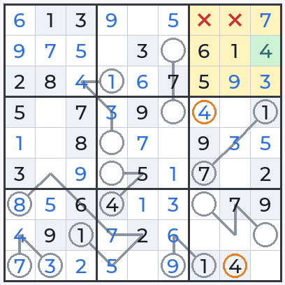

#### Step 34: the 4 in box 2

Box 2 needs a 4. r2c4 and r2c6: row 2 has one (r2c9). Only **r1c5** is left: **r1c5 = 4**.

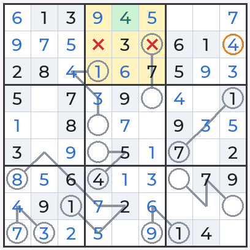

#### Step 35: the 4 in box 5

Box 5 needs a 4. r4c6: row 4 has one (r4c7). r5c4 and r6c4: column 4 has one (r7c4). Only **r5c6** is left: **r5c6 = 4**.

#### Step 36: the 4 in box 4

Box 4 needs a 4. r4c2: row 4 has one (r4c7). r5c2: row 5 has one (r5c6). Only **r6c2** is left: **r6c2 = 4**.

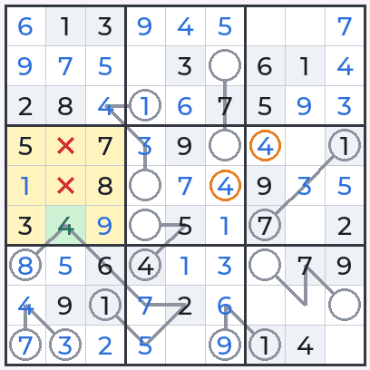

#### Step 37: the 2 in box 5

Box 5 needs a 2. r6c4: row 6 has one (r6c9). r5c4: it's a circle, and its line already has 3 and 4 between it and the 1 in r3c4: a 2 there wouldn't leave them strictly between. Only **r4c6** is left: **r4c6 = 2**.

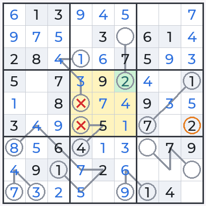

#### Step 38: the 2 in box 2

Box 2 needs a 2. r2c6: column 6 has one (r4c6). Only **r2c4** is left: **r2c4 = 2**.

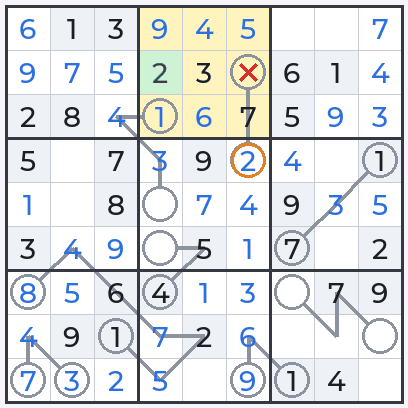

#### Step 39: the 8 in box 2

Box 2 needs an 8, and r2c6 is its last empty cell: **r2c6 = 8**.

#### Step 40: the 2 in box 4

Box 4 needs a 2. r4c2: row 4 has one (r4c6). Only **r5c2** is left: **r5c2 = 2**.

#### Step 41: the 6 in box 4

Box 4 needs a 6, and r4c2 is its last empty cell: **r4c2 = 6**.

#### Step 42: the 8 in box 5

Box 5 needs an 8. r5c4: row 5 has one (r5c3). Only **r6c4** is left: **r6c4 = 8**.

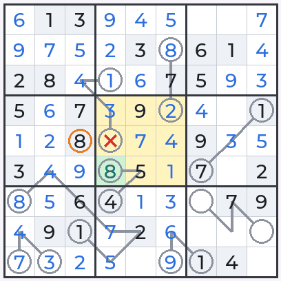

#### Step 43: the 6 in box 5

Box 5 needs a 6, and r5c4 is its last empty cell: **r5c4 = 6**.

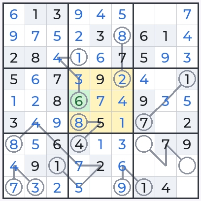

#### Step 44: the 6 in box 6

Box 6 needs a 6. r4c8: row 4 has one (r4c2). Only **r6c8** is left: **r6c8 = 6**.

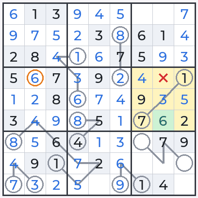

#### Step 45: the 8 in box 6

Box 6 needs an 8, and r4c8 is its last empty cell: **r4c8 = 8**.

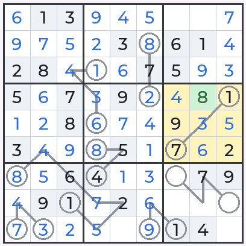

#### Step 46: the 8 in box 3

Box 3 needs an 8. r1c8: column 8 has one (r4c8). Only **r1c7** is left: **r1c7 = 8**.

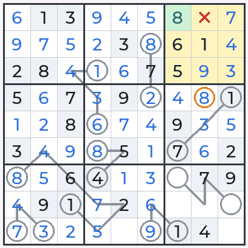

#### Step 47: the 2 in box 3

Box 3 needs a 2, and r1c8 is its last empty cell: **r1c8 = 2**.

#### Step 48: the 8 in box 8

Box 8 needs an 8, and r9c5 is its last empty cell: **r9c5 = 8**.

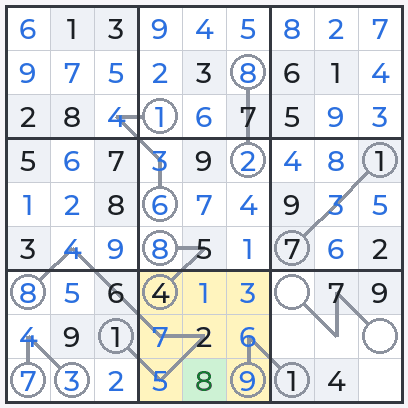

#### Step 49: the 2 in box 9

Box 9 needs a 2. r8c7, r8c8 and r8c9: row 8 has one (r8c5). r9c9: row 9 has one (r9c3). Only **r7c7** is left: **r7c7 = 2**.

#### Step 50: the 3 in box 9

Box 9 needs a 3. r8c8: column 8 has one (r5c8). r8c9: column 9 has one (r3c9). r9c9: row 9 has one (r9c2). Only **r8c7** is left: **r8c7 = 3**.

#### Step 51: the 5 in box 9

Box 9 needs a 5. r8c9: column 9 has one (r5c9). r9c9: row 9 has one (r9c4). Only **r8c8** is left: **r8c8 = 5**.

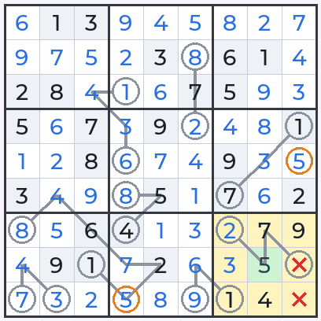

#### Step 52: the 6 in box 9

Box 9 needs a 6. r8c9: row 8 has one (r8c6). Only **r9c9** is left: **r9c9 = 6**.

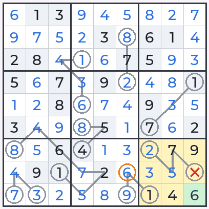

#### Step 53: the 8 in box 9

Box 9 needs an 8, and r8c9 is its last empty cell: **r8c9 = 8**.

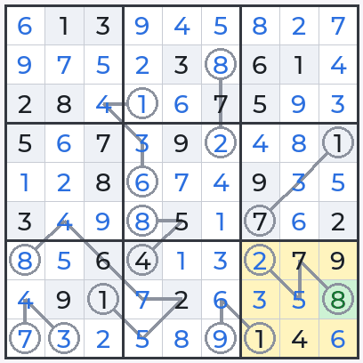

Solved.

<!-- /walkthrough -->
