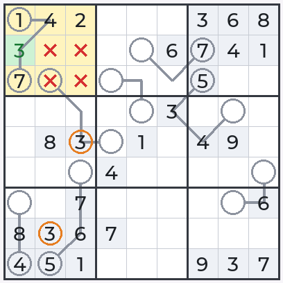

<!-- Written by tools/walkthrough.py between-lines: edit the script, not this page. -->
# Between Lines, step 1: the 6 in box 1

**Step 1 of 53** · [← The start](../between-lines.md#the-whole-puzzle-step-by-step) · [All steps](../between-lines.md#the-whole-puzzle-step-by-step) · [Step 2 →](step-02.md)

Box 1 needs a 6. r2c1, r2c2 and r2c3: row 2 has one (r2c7). r3c3: column 3 has one (r7c3). Only **r1c1** is left: **r1c1 = 6**.

**Step 1 of 53** · [← The start](../between-lines.md#the-whole-puzzle-step-by-step) · [All steps](../between-lines.md#the-whole-puzzle-step-by-step) · [Step 2 →](step-02.md)
