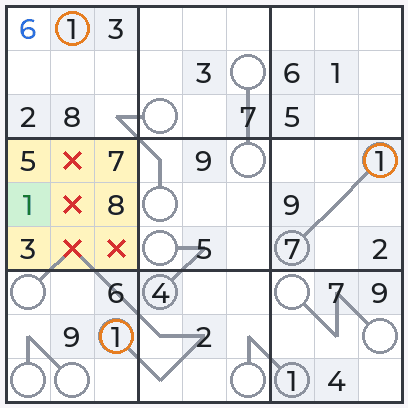

<!-- Written by tools/walkthrough.py between-lines: edit the script, not this page. -->
# Between Lines, step 2: the 1 in box 4

**Step 2 of 53** · [← Step 1](step-01.md) · [All steps](../between-lines.md#the-whole-puzzle-step-by-step) · [Step 3 →](step-03.md)

Box 4 needs a 1. r4c2: row 4 has one (r4c9). r5c2 and r6c2: column 2 has one (r1c2). r6c3: column 3 has one (r8c3). Only **r5c1** is left: **r5c1 = 1**.

**Step 2 of 53** · [← Step 1](step-01.md) · [All steps](../between-lines.md#the-whole-puzzle-step-by-step) · [Step 3 →](step-03.md)
