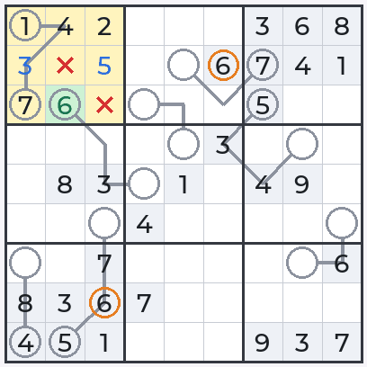

<!-- Written by tools/walkthrough.py between-lines: edit the script, not this page. -->
# Between Lines, step 3: the 9 in box 4

**Step 3 of 53** · [← Step 2](step-02.md) · [All steps](../between-lines.md#the-whole-puzzle-step-by-step) · [Step 4 →](step-04.md)

Box 4 needs a 9. r4c2: row 4 has one (r4c5). r5c2: row 5 has one (r5c7). r6c2: column 2 has one (r8c2). Only **r6c3** is left: **r6c3 = 9**.

**Step 3 of 53** · [← Step 2](step-02.md) · [All steps](../between-lines.md#the-whole-puzzle-step-by-step) · [Step 4 →](step-04.md)
