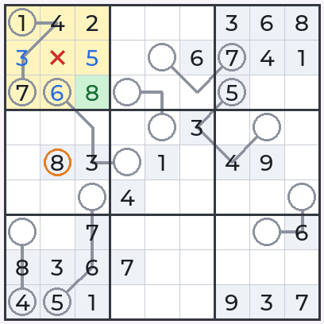

<!-- Written by tools/walkthrough.py between-lines: edit the script, not this page. -->
# Between Lines, step 4: the 9 in box 1

**Step 4 of 53** · [← Step 3](step-03.md) · [All steps](../between-lines.md#the-whole-puzzle-step-by-step) · [Step 5 →](step-05.md)

Box 1 needs a 9. r2c2: column 2 has one (r8c2). r2c3 and r3c3: column 3 has one (r6c3). Only **r2c1** is left: **r2c1 = 9**.

**Step 4 of 53** · [← Step 3](step-03.md) · [All steps](../between-lines.md#the-whole-puzzle-step-by-step) · [Step 5 →](step-05.md)
