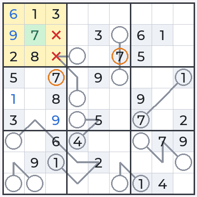

<!-- Written by tools/walkthrough.py between-lines: edit the script, not this page. -->
# Between Lines, step 5: the 7 in box 1

**Step 5 of 53** · [← Step 4](step-04.md) · [All steps](../between-lines.md#the-whole-puzzle-step-by-step) · [Step 6 →](step-06.md)

Box 1 needs a 7. r2c3: column 3 has one (r4c3). r3c3: row 3 has one (r3c6). Only **r2c2** is left: **r2c2 = 7**.

**Step 5 of 53** · [← Step 4](step-04.md) · [All steps](../between-lines.md#the-whole-puzzle-step-by-step) · [Step 6 →](step-06.md)
