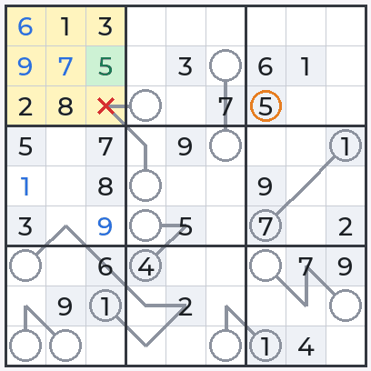

<!-- Written by tools/walkthrough.py between-lines: edit the script, not this page. -->
# Between Lines, step 6: the 5 in box 1

**Step 6 of 53** · [← Step 5](step-05.md) · [All steps](../between-lines.md#the-whole-puzzle-step-by-step) · [Step 7 →](step-07.md)

Box 1 needs a 5. r3c3: row 3 has one (r3c7). Only **r2c3** is left: **r2c3 = 5**.

**Step 6 of 53** · [← Step 5](step-05.md) · [All steps](../between-lines.md#the-whole-puzzle-step-by-step) · [Step 7 →](step-07.md)
