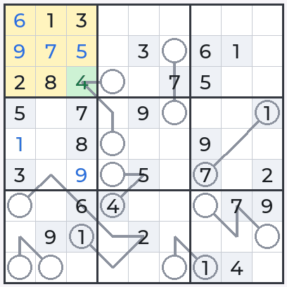

<!-- Written by tools/walkthrough.py between-lines: edit the script, not this page. -->
# Between Lines, step 7: the 4 in box 1

**Step 7 of 53** · [← Step 6](step-06.md) · [All steps](../between-lines.md#the-whole-puzzle-step-by-step) · [Step 8 →](step-08.md)

Box 1 needs a 4, and r3c3 is its last empty cell: **r3c3 = 4**.

**Step 7 of 53** · [← Step 6](step-06.md) · [All steps](../between-lines.md#the-whole-puzzle-step-by-step) · [Step 8 →](step-08.md)
