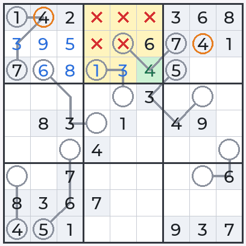

<!-- Written by tools/walkthrough.py between-lines: edit the script, not this page. -->
# Between Lines, step 8: the 7 in box 3

**Step 8 of 53** · [← Step 7](step-07.md) · [All steps](../between-lines.md#the-whole-puzzle-step-by-step) · [Step 9 →](step-09.md)

Box 3 needs a 7. r1c7: column 7 has one (r6c7). r1c8: column 8 has one (r7c8). r2c9: row 2 has one (r2c2). r3c8 and r3c9: row 3 has one (r3c6). Only **r1c9** is left: **r1c9 = 7**.

**Step 8 of 53** · [← Step 7](step-07.md) · [All steps](../between-lines.md#the-whole-puzzle-step-by-step) · [Step 9 →](step-09.md)
