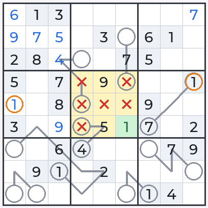

<!-- Written by tools/walkthrough.py between-lines: edit the script, not this page. -->
# Between Lines, step 9: the 1 in box 5

**Step 9 of 53** · [← Step 8](step-08.md) · [All steps](../between-lines.md#the-whole-puzzle-step-by-step) · [Step 10 →](step-10.md)

Box 5 needs a 1. r4c4 and r4c6: row 4 has one (r4c9). r5c4, r5c5 and r5c6: row 5 has one (r5c1). r6c4: it's a circle, and its line already has 5 between it and the 4 in r7c4: a 1 there wouldn't leave them strictly between. Only **r6c6** is left: **r6c6 = 1**.

**Step 9 of 53** · [← Step 8](step-08.md) · [All steps](../between-lines.md#the-whole-puzzle-step-by-step) · [Step 10 →](step-10.md)
