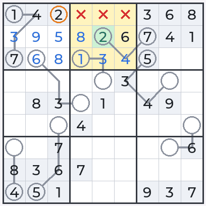

<!-- Written by tools/walkthrough.py between-lines: edit the script, not this page. -->
# Between Lines, step 10: the 4 in box 7

**Step 10 of 53** · [← Step 9](step-09.md) · [All steps](../between-lines.md#the-whole-puzzle-step-by-step) · [Step 11 →](step-11.md)

Box 7 needs a 4. r7c1 and r7c2: row 7 has one (r7c4). r9c1, r9c2 and r9c3: row 9 has one (r9c8). Only **r8c1** is left: **r8c1 = 4**.

**Step 10 of 53** · [← Step 9](step-09.md) · [All steps](../between-lines.md#the-whole-puzzle-step-by-step) · [Step 11 →](step-11.md)
