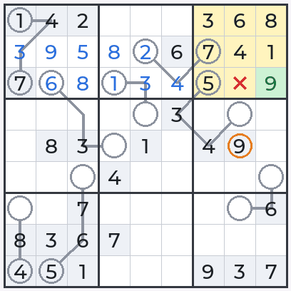

<!-- Written by tools/walkthrough.py between-lines: edit the script, not this page. -->
# Between Lines, step 11: the 7 in box 7

**Step 11 of 53** · [← Step 10](step-10.md) · [All steps](../between-lines.md#the-whole-puzzle-step-by-step) · [Step 12 →](step-12.md)

Box 7 needs a 7. r7c1 and r7c2: row 7 has one (r7c8). r9c2: column 2 has one (r2c2). r9c3: column 3 has one (r4c3). Only **r9c1** is left: **r9c1 = 7**.

**Step 11 of 53** · [← Step 10](step-10.md) · [All steps](../between-lines.md#the-whole-puzzle-step-by-step) · [Step 12 →](step-12.md)
