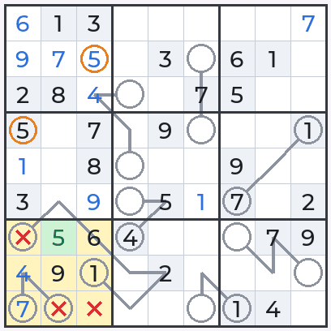

<!-- Written by tools/walkthrough.py between-lines: edit the script, not this page. -->
# Between Lines, step 12: the 5 in box 7

**Step 12 of 53** · [← Step 11](step-11.md) · [All steps](../between-lines.md#the-whole-puzzle-step-by-step) · [Step 13 →](step-13.md)

Box 7 needs a 5. r7c1: column 1 has one (r4c1). r9c3: column 3 has one (r2c3). r9c2: it's a circle, and its line already has 4 between it and the 7 in r9c1: a 5 there wouldn't leave them strictly between. Only **r7c2** is left: **r7c2 = 5**.

**Step 12 of 53** · [← Step 11](step-11.md) · [All steps](../between-lines.md#the-whole-puzzle-step-by-step) · [Step 13 →](step-13.md)
