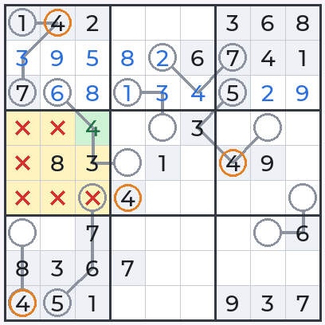

<!-- Written by tools/walkthrough.py between-lines: edit the script, not this page. -->
# Between Lines, step 13: the 3 in box 7

**Step 13 of 53** · [← Step 12](step-12.md) · [All steps](../between-lines.md#the-whole-puzzle-step-by-step) · [Step 14 →](step-14.md)

Box 7 needs a 3. r7c1: column 1 has one (r6c1). r9c3: column 3 has one (r1c3). Only **r9c2** is left: **r9c2 = 3**.

**Step 13 of 53** · [← Step 12](step-12.md) · [All steps](../between-lines.md#the-whole-puzzle-step-by-step) · [Step 14 →](step-14.md)
