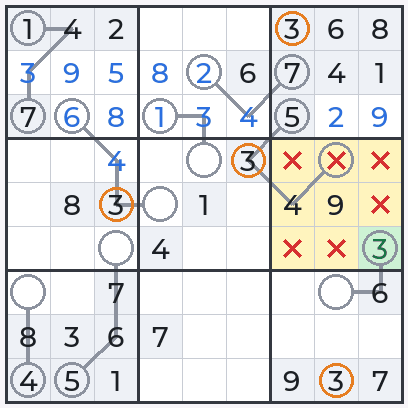

<!-- Written by tools/walkthrough.py between-lines: edit the script, not this page. -->
# Between Lines, step 14: the 2 in box 7

**Step 14 of 53** · [← Step 13](step-13.md) · [All steps](../between-lines.md#the-whole-puzzle-step-by-step) · [Step 15 →](step-15.md)

Box 7 needs a 2. r7c1: column 1 has one (r3c1). Only **r9c3** is left: **r9c3 = 2**.

**Step 14 of 53** · [← Step 13](step-13.md) · [All steps](../between-lines.md#the-whole-puzzle-step-by-step) · [Step 15 →](step-15.md)
