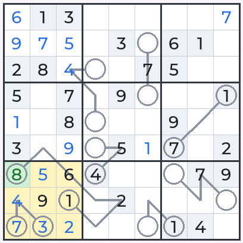

<!-- Written by tools/walkthrough.py between-lines: edit the script, not this page. -->
# Between Lines, step 15: the 8 in box 7

**Step 15 of 53** · [← Step 14](step-14.md) · [All steps](../between-lines.md#the-whole-puzzle-step-by-step) · [Step 16 →](step-16.md)

Box 7 needs an 8, and r7c1 is its last empty cell: **r7c1 = 8**.

**Step 15 of 53** · [← Step 14](step-14.md) · [All steps](../between-lines.md#the-whole-puzzle-step-by-step) · [Step 16 →](step-16.md)
