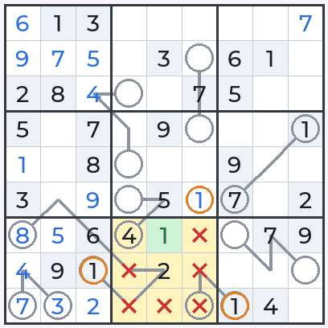

<!-- Written by tools/walkthrough.py between-lines: edit the script, not this page. -->
# Between Lines, step 16: the 1 in box 8

**Step 16 of 53** · [← Step 15](step-15.md) · [All steps](../between-lines.md#the-whole-puzzle-step-by-step) · [Step 17 →](step-17.md)

Box 8 needs a 1. r7c6: column 6 has one (r6c6). r8c4 and r8c6: row 8 has one (r8c3). r9c4, r9c5 and r9c6: row 9 has one (r9c7). Only **r7c5** is left: **r7c5 = 1**.

**Step 16 of 53** · [← Step 15](step-15.md) · [All steps](../between-lines.md#the-whole-puzzle-step-by-step) · [Step 17 →](step-17.md)
