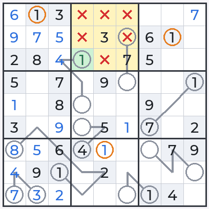

<!-- Written by tools/walkthrough.py between-lines: edit the script, not this page. -->
# Between Lines, step 17: the 1 in box 2

**Step 17 of 53** · [← Step 16](step-16.md) · [All steps](../between-lines.md#the-whole-puzzle-step-by-step) · [Step 18 →](step-18.md)

Box 2 needs a 1. r1c4, r1c5 and r1c6: row 1 has one (r1c2). r2c4 and r2c6: row 2 has one (r2c8). r3c5: column 5 has one (r7c5). Only **r3c4** is left: **r3c4 = 1**.

**Step 17 of 53** · [← Step 16](step-16.md) · [All steps](../between-lines.md#the-whole-puzzle-step-by-step) · [Step 18 →](step-18.md)
