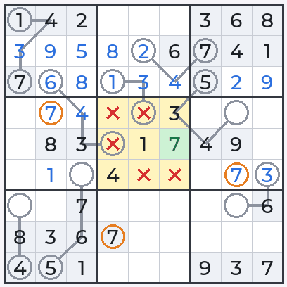

<!-- Written by tools/walkthrough.py between-lines: edit the script, not this page. -->
# Between Lines, step 18: the 6 in box 2

**Step 18 of 53** · [← Step 17](step-17.md) · [All steps](../between-lines.md#the-whole-puzzle-step-by-step) · [Step 19 →](step-19.md)

Box 2 needs a 6. r1c4, r1c5 and r1c6: row 1 has one (r1c1). r2c4 and r2c6: row 2 has one (r2c7). Only **r3c5** is left: **r3c5 = 6**.

**Step 18 of 53** · [← Step 17](step-17.md) · [All steps](../between-lines.md#the-whole-puzzle-step-by-step) · [Step 19 →](step-19.md)
