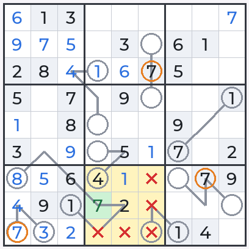

<!-- Written by tools/walkthrough.py between-lines: edit the script, not this page. -->
# Between Lines, step 19: the 7 in box 8

**Step 19 of 53** · [← Step 18](step-18.md) · [All steps](../between-lines.md#the-whole-puzzle-step-by-step) · [Step 20 →](step-20.md)

Box 8 needs a 7. r7c6: row 7 has one (r7c8). r8c6: column 6 has one (r3c6). r9c4, r9c5 and r9c6: row 9 has one (r9c1). Only **r8c4** is left: **r8c4 = 7**.

**Step 19 of 53** · [← Step 18](step-18.md) · [All steps](../between-lines.md#the-whole-puzzle-step-by-step) · [Step 20 →](step-20.md)
