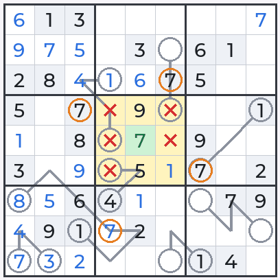

<!-- Written by tools/walkthrough.py between-lines: edit the script, not this page. -->
# Between Lines, step 20: the 7 in box 5

**Step 20 of 53** · [← Step 19](step-19.md) · [All steps](../between-lines.md#the-whole-puzzle-step-by-step) · [Step 21 →](step-21.md)

Box 5 needs a 7. r4c4 and r4c6: row 4 has one (r4c3). r5c4: column 4 has one (r8c4). r5c6: column 6 has one (r3c6). r6c4: row 6 has one (r6c7). Only **r5c5** is left: **r5c5 = 7**.

**Step 20 of 53** · [← Step 19](step-19.md) · [All steps](../between-lines.md#the-whole-puzzle-step-by-step) · [Step 21 →](step-21.md)
