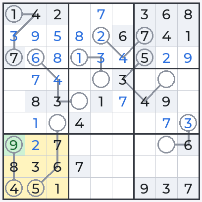

<!-- Written by tools/walkthrough.py between-lines: edit the script, not this page. -->
# Between Lines, step 21: the 9 in box 8

**Step 21 of 53** · [← Step 20](step-20.md) · [All steps](../between-lines.md#the-whole-puzzle-step-by-step) · [Step 22 →](step-22.md)

Box 8 needs a 9. r7c6: row 7 has one (r7c9). r8c6: row 8 has one (r8c2). r9c5: column 5 has one (r4c5). r9c4: it's on the line between the circles 1 and 8, so it's 2 to 7. Only **r9c6** is left: **r9c6 = 9**.

**Step 21 of 53** · [← Step 20](step-20.md) · [All steps](../between-lines.md#the-whole-puzzle-step-by-step) · [Step 22 →](step-22.md)
