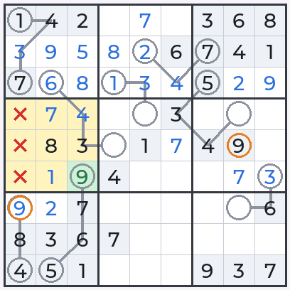

<!-- Written by tools/walkthrough.py between-lines: edit the script, not this page. -->
# Between Lines, step 22: the 9 in box 2

**Step 22 of 53** · [← Step 21](step-21.md) · [All steps](../between-lines.md#the-whole-puzzle-step-by-step) · [Step 23 →](step-23.md)

Box 2 needs a 9. r1c5: column 5 has one (r4c5). r1c6: column 6 has one (r9c6). r2c4 and r2c6: row 2 has one (r2c1). Only **r1c4** is left: **r1c4 = 9**.

**Step 22 of 53** · [← Step 21](step-21.md) · [All steps](../between-lines.md#the-whole-puzzle-step-by-step) · [Step 23 →](step-23.md)
