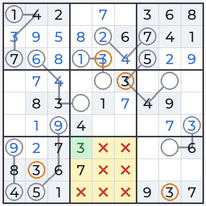

<!-- Written by tools/walkthrough.py between-lines: edit the script, not this page. -->
# Between Lines, step 23: the 5 in box 2

**Step 23 of 53** · [← Step 22](step-22.md) · [All steps](../between-lines.md#the-whole-puzzle-step-by-step) · [Step 24 →](step-24.md)

Box 2 needs a 5. r1c5: column 5 has one (r6c5). r2c4 and r2c6: row 2 has one (r2c3). Only **r1c6** is left: **r1c6 = 5**.

**Step 23 of 53** · [← Step 22](step-22.md) · [All steps](../between-lines.md#the-whole-puzzle-step-by-step) · [Step 24 →](step-24.md)
