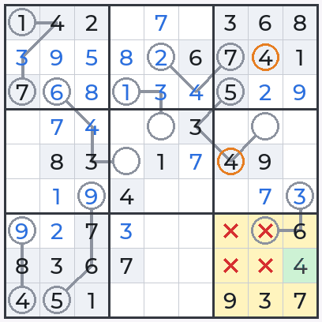

<!-- Written by tools/walkthrough.py between-lines: edit the script, not this page. -->
# Between Lines, step 24: the 9 in box 3

**Step 24 of 53** · [← Step 23](step-23.md) · [All steps](../between-lines.md#the-whole-puzzle-step-by-step) · [Step 25 →](step-25.md)

Box 3 needs a 9. r1c7 and r1c8: row 1 has one (r1c4). r2c9: row 2 has one (r2c1). r3c9: column 9 has one (r7c9). Only **r3c8** is left: **r3c8 = 9**.

**Step 24 of 53** · [← Step 23](step-23.md) · [All steps](../between-lines.md#the-whole-puzzle-step-by-step) · [Step 25 →](step-25.md)
