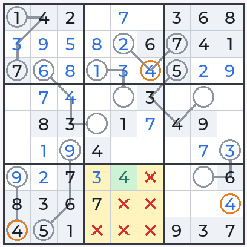

<!-- Written by tools/walkthrough.py between-lines: edit the script, not this page. -->
# Between Lines, step 25: the 3 in box 3

**Step 25 of 53** · [← Step 24](step-24.md) · [All steps](../between-lines.md#the-whole-puzzle-step-by-step) · [Step 26 →](step-26.md)

Box 3 needs a 3. r1c7 and r1c8: row 1 has one (r1c3). r2c9: row 2 has one (r2c5). Only **r3c9** is left: **r3c9 = 3**.

**Step 25 of 53** · [← Step 24](step-24.md) · [All steps](../between-lines.md#the-whole-puzzle-step-by-step) · [Step 26 →](step-26.md)
