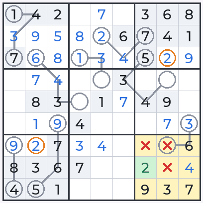

<!-- Written by tools/walkthrough.py between-lines: edit the script, not this page. -->
# Between Lines, step 26: the 5 in box 8

**Step 26 of 53** · [← Step 25](step-25.md) · [All steps](../between-lines.md#the-whole-puzzle-step-by-step) · [Step 27 →](step-27.md)

Box 8 needs a 5. r7c6: row 7 has one (r7c2). r8c6: column 6 has one (r1c6). r9c5: column 5 has one (r6c5). Only **r9c4** is left: **r9c4 = 5**.

**Step 26 of 53** · [← Step 25](step-25.md) · [All steps](../between-lines.md#the-whole-puzzle-step-by-step) · [Step 27 →](step-27.md)
