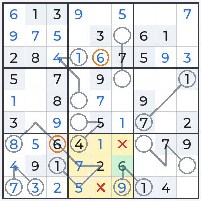

<!-- Written by tools/walkthrough.py between-lines: edit the script, not this page. -->
# Between Lines, step 27: the 6 in box 8

**Step 27 of 53** · [← Step 26](step-26.md) · [All steps](../between-lines.md#the-whole-puzzle-step-by-step) · [Step 28 →](step-28.md)

Box 8 needs a 6. r7c6: row 7 has one (r7c3). r9c5: column 5 has one (r3c5). Only **r8c6** is left: **r8c6 = 6**.

**Step 27 of 53** · [← Step 26](step-26.md) · [All steps](../between-lines.md#the-whole-puzzle-step-by-step) · [Step 28 →](step-28.md)
