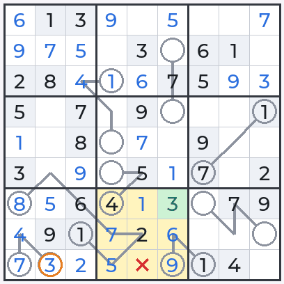

<!-- Written by tools/walkthrough.py between-lines: edit the script, not this page. -->
# Between Lines, step 28: the 3 in box 8

**Step 28 of 53** · [← Step 27](step-27.md) · [All steps](../between-lines.md#the-whole-puzzle-step-by-step) · [Step 29 →](step-29.md)

Box 8 needs a 3. r9c5: row 9 has one (r9c2). Only **r7c6** is left: **r7c6 = 3**.

**Step 28 of 53** · [← Step 27](step-27.md) · [All steps](../between-lines.md#the-whole-puzzle-step-by-step) · [Step 29 →](step-29.md)
