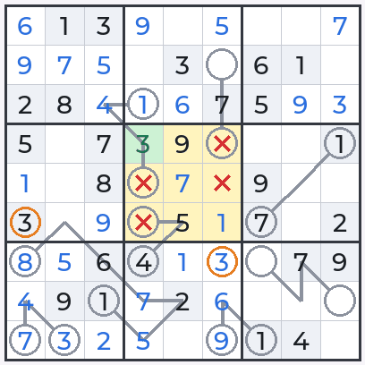

<!-- Written by tools/walkthrough.py between-lines: edit the script, not this page. -->
# Between Lines, step 29: the 3 in box 5

**Step 29 of 53** · [← Step 28](step-28.md) · [All steps](../between-lines.md#the-whole-puzzle-step-by-step) · [Step 30 →](step-30.md)

Box 5 needs a 3. r4c6 and r5c6: column 6 has one (r7c6). r6c4: row 6 has one (r6c1). r5c4: it's a circle, and its line already has 4 between it and the 1 in r3c4: a 3 there wouldn't leave them strictly between. Only **r4c4** is left: **r4c4 = 3**.

**Step 29 of 53** · [← Step 28](step-28.md) · [All steps](../between-lines.md#the-whole-puzzle-step-by-step) · [Step 30 →](step-30.md)
