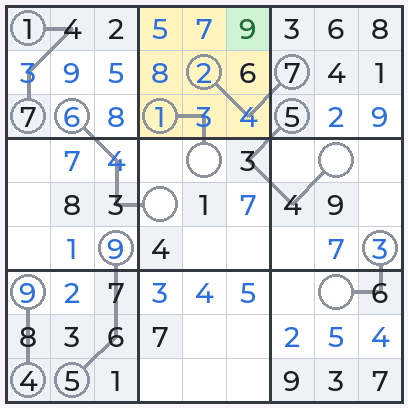

<!-- Written by tools/walkthrough.py between-lines: edit the script, not this page. -->
# Between Lines, step 30: the 3 in box 6

**Step 30 of 53** · [← Step 29](step-29.md) · [All steps](../between-lines.md#the-whole-puzzle-step-by-step) · [Step 31 →](step-31.md)

Box 6 needs a 3. r4c7 and r4c8: row 4 has one (r4c4). r5c9: column 9 has one (r3c9). r6c8: row 6 has one (r6c1). Only **r5c8** is left: **r5c8 = 3**.

**Step 30 of 53** · [← Step 29](step-29.md) · [All steps](../between-lines.md#the-whole-puzzle-step-by-step) · [Step 31 →](step-31.md)
