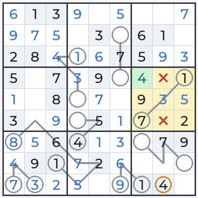

<!-- Written by tools/walkthrough.py between-lines: edit the script, not this page. -->
# Between Lines, step 32: the 4 in box 6

**Step 32 of 53** · [← Step 31](step-31.md) · [All steps](../between-lines.md#the-whole-puzzle-step-by-step) · [Step 33 →](step-33.md)

Box 6 needs a 4. r4c8 and r6c8: column 8 has one (r9c8). Only **r4c7** is left: **r4c7 = 4**.

**Step 32 of 53** · [← Step 31](step-31.md) · [All steps](../between-lines.md#the-whole-puzzle-step-by-step) · [Step 33 →](step-33.md)
