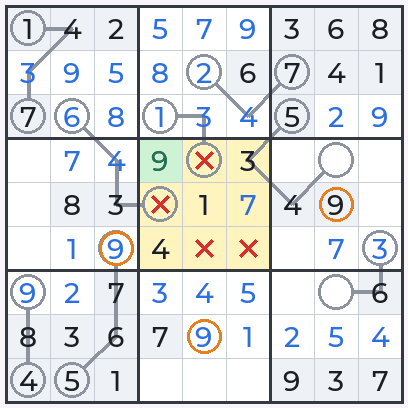

<!-- Written by tools/walkthrough.py between-lines: edit the script, not this page. -->
# Between Lines, step 33: the 4 in box 3

**Step 33 of 53** · [← Step 32](step-32.md) · [All steps](../between-lines.md#the-whole-puzzle-step-by-step) · [Step 34 →](step-34.md)

Box 3 needs a 4. r1c7: column 7 has one (r4c7). r1c8: column 8 has one (r9c8). Only **r2c9** is left: **r2c9 = 4**.

**Step 33 of 53** · [← Step 32](step-32.md) · [All steps](../between-lines.md#the-whole-puzzle-step-by-step) · [Step 34 →](step-34.md)
