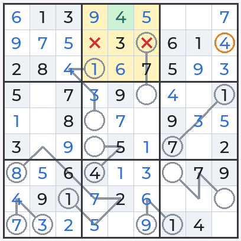

<!-- Written by tools/walkthrough.py between-lines: edit the script, not this page. -->
# Between Lines, step 34: the 4 in box 2

**Step 34 of 53** · [← Step 33](step-33.md) · [All steps](../between-lines.md#the-whole-puzzle-step-by-step) · [Step 35 →](step-35.md)

Box 2 needs a 4. r2c4 and r2c6: row 2 has one (r2c9). Only **r1c5** is left: **r1c5 = 4**.

**Step 34 of 53** · [← Step 33](step-33.md) · [All steps](../between-lines.md#the-whole-puzzle-step-by-step) · [Step 35 →](step-35.md)
