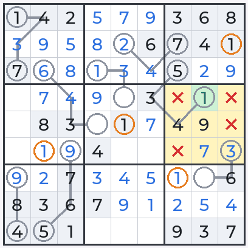

<!-- Written by tools/walkthrough.py between-lines: edit the script, not this page. -->
# Between Lines, step 35: the 4 in box 5

**Step 35 of 53** · [← Step 34](step-34.md) · [All steps](../between-lines.md#the-whole-puzzle-step-by-step) · [Step 36 →](step-36.md)

Box 5 needs a 4. r4c6: row 4 has one (r4c7). r5c4 and r6c4: column 4 has one (r7c4). Only **r5c6** is left: **r5c6 = 4**.

**Step 35 of 53** · [← Step 34](step-34.md) · [All steps](../between-lines.md#the-whole-puzzle-step-by-step) · [Step 36 →](step-36.md)
