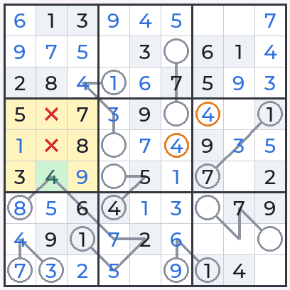

<!-- Written by tools/walkthrough.py between-lines: edit the script, not this page. -->
# Between Lines, step 36: the 4 in box 4

**Step 36 of 53** · [← Step 35](step-35.md) · [All steps](../between-lines.md#the-whole-puzzle-step-by-step) · [Step 37 →](step-37.md)

Box 4 needs a 4. r4c2: row 4 has one (r4c7). r5c2: row 5 has one (r5c6). Only **r6c2** is left: **r6c2 = 4**.

**Step 36 of 53** · [← Step 35](step-35.md) · [All steps](../between-lines.md#the-whole-puzzle-step-by-step) · [Step 37 →](step-37.md)
