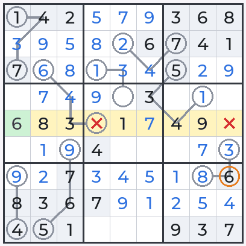

<!-- Written by tools/walkthrough.py between-lines: edit the script, not this page. -->
# Between Lines, step 37: the 2 in box 5

**Step 37 of 53** · [← Step 36](step-36.md) · [All steps](../between-lines.md#the-whole-puzzle-step-by-step) · [Step 38 →](step-38.md)

Box 5 needs a 2. r6c4: row 6 has one (r6c9). r5c4: it's a circle, and its line already has 3 and 4 between it and the 1 in r3c4: a 2 there wouldn't leave them strictly between. Only **r4c6** is left: **r4c6 = 2**.

**Step 37 of 53** · [← Step 36](step-36.md) · [All steps](../between-lines.md#the-whole-puzzle-step-by-step) · [Step 38 →](step-38.md)
