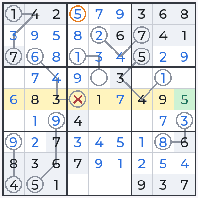

<!-- Written by tools/walkthrough.py between-lines: edit the script, not this page. -->
# Between Lines, step 38: the 2 in box 2

**Step 38 of 53** · [← Step 37](step-37.md) · [All steps](../between-lines.md#the-whole-puzzle-step-by-step) · [Step 39 →](step-39.md)

Box 2 needs a 2. r2c6: column 6 has one (r4c6). Only **r2c4** is left: **r2c4 = 2**.

**Step 38 of 53** · [← Step 37](step-37.md) · [All steps](../between-lines.md#the-whole-puzzle-step-by-step) · [Step 39 →](step-39.md)
