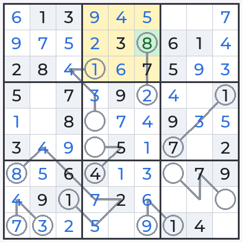

<!-- Written by tools/walkthrough.py between-lines: edit the script, not this page. -->
# Between Lines, step 39: the 8 in box 2

**Step 39 of 53** · [← Step 38](step-38.md) · [All steps](../between-lines.md#the-whole-puzzle-step-by-step) · [Step 40 →](step-40.md)

Box 2 needs an 8, and r2c6 is its last empty cell: **r2c6 = 8**.

**Step 39 of 53** · [← Step 38](step-38.md) · [All steps](../between-lines.md#the-whole-puzzle-step-by-step) · [Step 40 →](step-40.md)
