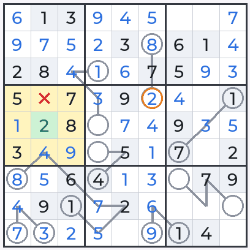

<!-- Written by tools/walkthrough.py between-lines: edit the script, not this page. -->
# Between Lines, step 40: the 2 in box 4

**Step 40 of 53** · [← Step 39](step-39.md) · [All steps](../between-lines.md#the-whole-puzzle-step-by-step) · [Step 41 →](step-41.md)

Box 4 needs a 2. r4c2: row 4 has one (r4c6). Only **r5c2** is left: **r5c2 = 2**.

**Step 40 of 53** · [← Step 39](step-39.md) · [All steps](../between-lines.md#the-whole-puzzle-step-by-step) · [Step 41 →](step-41.md)
