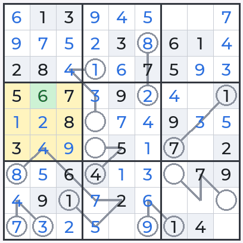

<!-- Written by tools/walkthrough.py between-lines: edit the script, not this page. -->
# Between Lines, step 41: the 6 in box 4

**Step 41 of 53** · [← Step 40](step-40.md) · [All steps](../between-lines.md#the-whole-puzzle-step-by-step) · [Step 42 →](step-42.md)

Box 4 needs a 6, and r4c2 is its last empty cell: **r4c2 = 6**.

**Step 41 of 53** · [← Step 40](step-40.md) · [All steps](../between-lines.md#the-whole-puzzle-step-by-step) · [Step 42 →](step-42.md)
