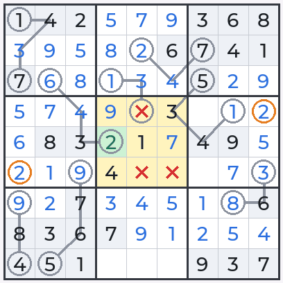

<!-- Written by tools/walkthrough.py between-lines: edit the script, not this page. -->
# Between Lines, step 42: the 8 in box 5

**Step 42 of 53** · [← Step 41](step-41.md) · [All steps](../between-lines.md#the-whole-puzzle-step-by-step) · [Step 43 →](step-43.md)

Box 5 needs an 8. r5c4: row 5 has one (r5c3). Only **r6c4** is left: **r6c4 = 8**.

**Step 42 of 53** · [← Step 41](step-41.md) · [All steps](../between-lines.md#the-whole-puzzle-step-by-step) · [Step 43 →](step-43.md)
