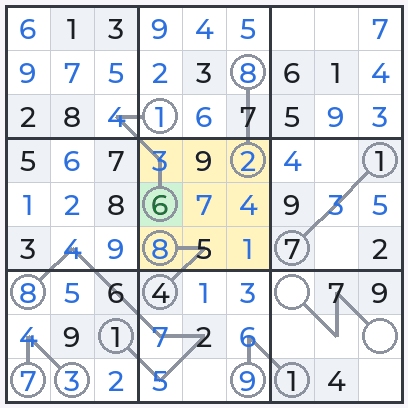

<!-- Written by tools/walkthrough.py between-lines: edit the script, not this page. -->
# Between Lines, step 43: the 6 in box 5

**Step 43 of 53** · [← Step 42](step-42.md) · [All steps](../between-lines.md#the-whole-puzzle-step-by-step) · [Step 44 →](step-44.md)

Box 5 needs a 6, and r5c4 is its last empty cell: **r5c4 = 6**.

**Step 43 of 53** · [← Step 42](step-42.md) · [All steps](../between-lines.md#the-whole-puzzle-step-by-step) · [Step 44 →](step-44.md)
