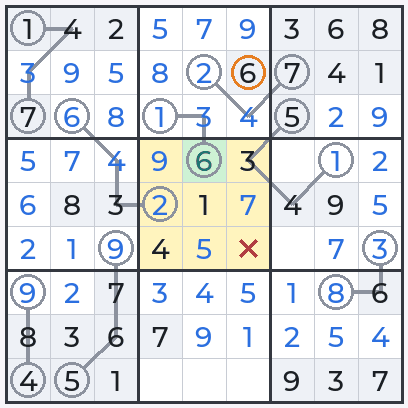

<!-- Written by tools/walkthrough.py between-lines: edit the script, not this page. -->
# Between Lines, step 44: the 6 in box 6

**Step 44 of 53** · [← Step 43](step-43.md) · [All steps](../between-lines.md#the-whole-puzzle-step-by-step) · [Step 45 →](step-45.md)

Box 6 needs a 6. r4c8: row 4 has one (r4c2). Only **r6c8** is left: **r6c8 = 6**.

**Step 44 of 53** · [← Step 43](step-43.md) · [All steps](../between-lines.md#the-whole-puzzle-step-by-step) · [Step 45 →](step-45.md)
