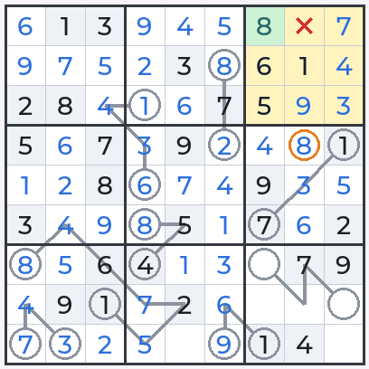

<!-- Written by tools/walkthrough.py between-lines: edit the script, not this page. -->
# Between Lines, step 46: the 8 in box 3

**Step 46 of 53** · [← Step 45](step-45.md) · [All steps](../between-lines.md#the-whole-puzzle-step-by-step) · [Step 47 →](step-47.md)

Box 3 needs an 8. r1c8: column 8 has one (r4c8). Only **r1c7** is left: **r1c7 = 8**.

**Step 46 of 53** · [← Step 45](step-45.md) · [All steps](../between-lines.md#the-whole-puzzle-step-by-step) · [Step 47 →](step-47.md)
