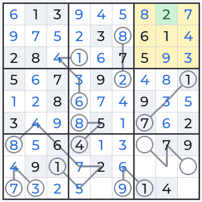

<!-- Written by tools/walkthrough.py between-lines: edit the script, not this page. -->
# Between Lines, step 47: the 2 in box 3

**Step 47 of 53** · [← Step 46](step-46.md) · [All steps](../between-lines.md#the-whole-puzzle-step-by-step) · [Step 48 →](step-48.md)

Box 3 needs a 2, and r1c8 is its last empty cell: **r1c8 = 2**.

**Step 47 of 53** · [← Step 46](step-46.md) · [All steps](../between-lines.md#the-whole-puzzle-step-by-step) · [Step 48 →](step-48.md)
