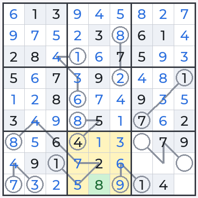

<!-- Written by tools/walkthrough.py between-lines: edit the script, not this page. -->
# Between Lines, step 48: the 8 in box 8

**Step 48 of 53** · [← Step 47](step-47.md) · [All steps](../between-lines.md#the-whole-puzzle-step-by-step) · [Step 49 →](step-49.md)

Box 8 needs an 8, and r9c5 is its last empty cell: **r9c5 = 8**.

**Step 48 of 53** · [← Step 47](step-47.md) · [All steps](../between-lines.md#the-whole-puzzle-step-by-step) · [Step 49 →](step-49.md)
