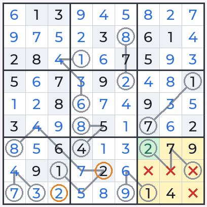

<!-- Written by tools/walkthrough.py between-lines: edit the script, not this page. -->
# Between Lines, step 49: the 2 in box 9

**Step 49 of 53** · [← Step 48](step-48.md) · [All steps](../between-lines.md#the-whole-puzzle-step-by-step) · [Step 50 →](step-50.md)

Box 9 needs a 2. r8c7, r8c8 and r8c9: row 8 has one (r8c5). r9c9: row 9 has one (r9c3). Only **r7c7** is left: **r7c7 = 2**.

**Step 49 of 53** · [← Step 48](step-48.md) · [All steps](../between-lines.md#the-whole-puzzle-step-by-step) · [Step 50 →](step-50.md)
