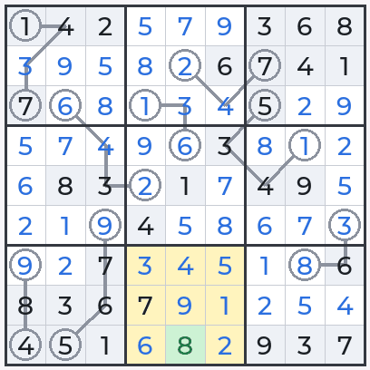

<!-- Written by tools/walkthrough.py between-lines: edit the script, not this page. -->
# Between Lines, step 50: the 3 in box 9

**Step 50 of 53** · [← Step 49](step-49.md) · [All steps](../between-lines.md#the-whole-puzzle-step-by-step) · [Step 51 →](step-51.md)

Box 9 needs a 3. r8c8: column 8 has one (r5c8). r8c9: column 9 has one (r3c9). r9c9: row 9 has one (r9c2). Only **r8c7** is left: **r8c7 = 3**.

**Step 50 of 53** · [← Step 49](step-49.md) · [All steps](../between-lines.md#the-whole-puzzle-step-by-step) · [Step 51 →](step-51.md)
