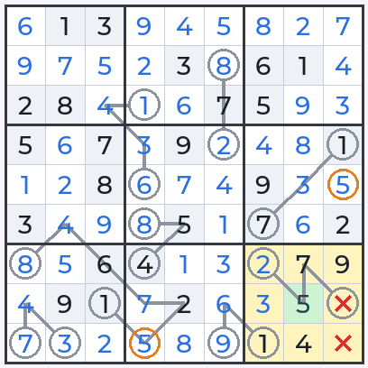

<!-- Written by tools/walkthrough.py between-lines: edit the script, not this page. -->
# Between Lines, step 51: the 5 in box 9

**Step 51 of 53** · [← Step 50](step-50.md) · [All steps](../between-lines.md#the-whole-puzzle-step-by-step) · [Step 52 →](step-52.md)

Box 9 needs a 5. r8c9: column 9 has one (r5c9). r9c9: row 9 has one (r9c4). Only **r8c8** is left: **r8c8 = 5**.

**Step 51 of 53** · [← Step 50](step-50.md) · [All steps](../between-lines.md#the-whole-puzzle-step-by-step) · [Step 52 →](step-52.md)
